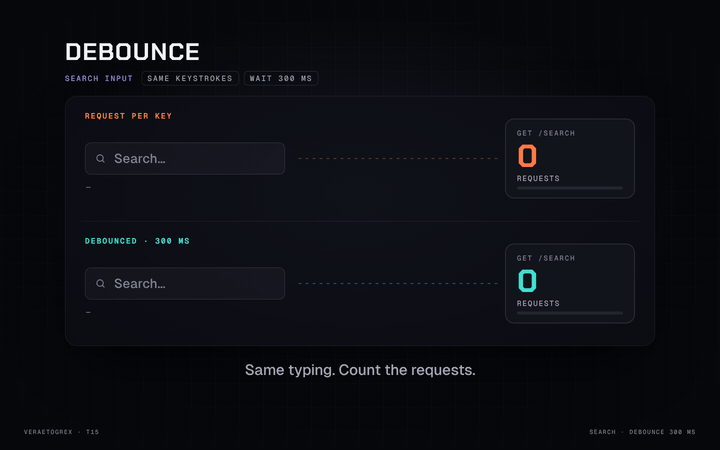

# Debounce Search

**Same 9 keystrokes. 9 requests or 1.**



**Live demo:** [veraetogrex-portfolio.github.io/debounce-search](https://veraetogrex-portfolio.github.io/debounce-search/) · **Mockup:** [full-screen version](https://veraetogrex-portfolio.github.io/debounce-search/mockup/debounce-search.html)

One search box, two strategies. The top box hits the server on every key. The bottom one drops each key into a waiting bubble, and 300 ms of quiet sends it as a single request.

## Use it

Three files, no build step, no dependencies, no web fonts:

```
index.html   markup
style.css    styles and keyframes
script.js    behaviour
```

Download the repo and open `index.html`, or copy the three files into your project.

## Try it

- Type into either search box: the top lane fires a request per key, the bottom lane waits for a pause.
- The counters show how many requests each strategy sent; the bubble ring shows the 300 ms timer restarting on every key.

## Make it yours

`WAIT` at the top of `script.js` is the debounce delay in ms. `debounce(fn, ms)` is a standalone helper you can lift into any project.

## What's in `mockup/`

The full 1440×900 screen this component was shot in for the reel:

- `mockup/debounce-search.html` — interactive. `D` plays the demo, `R` resets.
- `mockup/debounce-search.autoplay.html` — the scripted loop the reel was recorded from.
- URL flags: `?frame` puts the screen in a browser window, `?clean` hides the control panel, `?once` plays the demo once.

The mockup loads the same `style.css` and `script.js` from the root, plus a shared stage runtime and bundled fonts from `mockup/_shared/`. The component in the root doesn't need any of it.

---

Component 15 of a series. New one every day on Instagram [@veraetogrex_portfolio](https://www.instagram.com/veraetogrex_portfolio/) · all components: [github.com/veraetogrex-portfolio](https://github.com/veraetogrex-portfolio)

MIT licensed.
